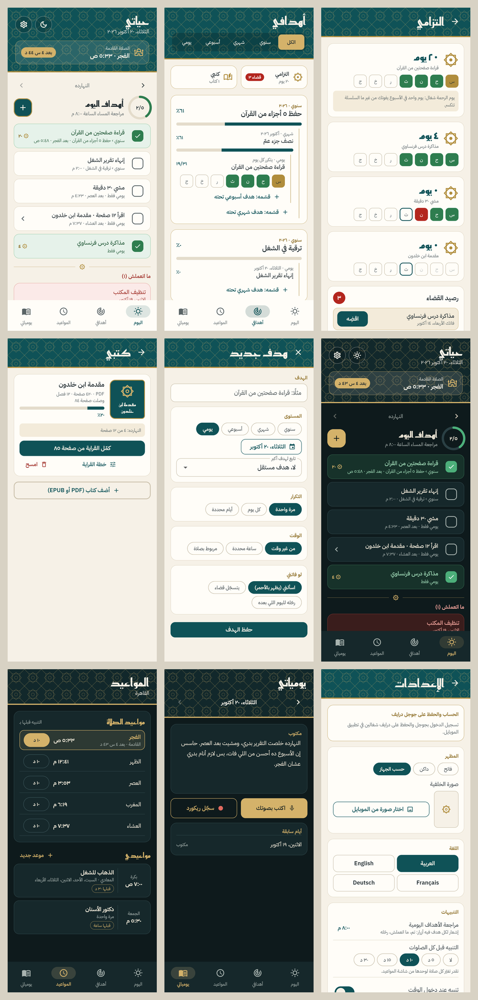

# حياتي

تطبيق أهداف ومواعيد ويوميات، بتصميم عربي مزخرف، بالعربي والإنجليزي والفرنساوي والألماني، وبيدعم الوضع الفاتح والداكن.



## اللي في التطبيق

- **أهدافي:** سنوي ← شهري ← أسبوعي ← يومي، وتقدر تبدأ من أي مستوى. التقدم بيتحسب لوحده من تحت لفوق.
- **اليوم:** أهداف النهارده. اللي خلص لونه أخضر، واللي فات ولسه ما اتقررش مصيره بيظهر بالأحمر وجنبه 3 أزرار: رحّله لليوم، قضاء، امسحه. وتقدر ترجع لأيام فاتت وتعلّم عليها.
- **هدف مربوط بالصلاة:** مثلًا "بعد الفجر بـ 15 دقيقة"، والميعاد بيتحرك لوحده مع الصلاة كل يوم.
- **القضاء ويوم الرحمة:** الهدف اللي فاتك يتسجّل قضاء وتقضيه بعدين (مثلًا يوم الجمعة). ويوم واحد في الأسبوع يفوتك من غير ما السلسلة تتكسر.
- **إشعار الساعة 8 بالليل:** إشعار لكل هدف فيه أزرار: تم، ما اتعملش، رحّله لبكرة. تعلّم من غير ما تفتح التطبيق، والساعة بتتغير من الإعدادات.
- **المواعيد:** مواقيت الصلاة لمدن مصر بطريقة الهيئة المصرية العامة للمساحة، والتوقيت الصيفي محسوب. لكل صلاة تنبيه قبلها بالمدة اللي تختارها، ومعاها مواعيدك المتغيرة والمتكررة.
- **يومياتي:** تكتب، أو تتكلم وهو يكتب (بخدمة التعرف على الكلام اللي في الموبايل)، أو تسجّل ريكورد صوت.
- **كتبي:** تضيف كتاب PDF أو EPUB، وتختار خطة: خلّصه في مدة، أو فصول في الأسبوع، أو صفحات في اليوم. بيتعمل هدف يومي لوحده، ويتعلّم عليه صح أول ما توصل للمطلوب في القارئ.
- **صورة خلفية** من الموبايل.
- **حساب جوجل والحفظ على Google Drive:** كل حاجة بتتحفظ في فولدر مخفي خاص بالتطبيق في درايف بتاعك. لو التطبيق اتمسح، تسجّل دخول تاني وكل حاجة ترجع.

## تنزيل التطبيق على الموبايل (أندرويد)

كل ما الكود يتحدّث على GitHub، GitHub بيبني التطبيق لوحده. علشان تسطّبه:
1. افتح صفحة **Releases** في الريبو.
2. نزّل ملف `hayati.apk` وافتحه على الموبايل.
3. لو الموبايل طلب إذن تسطيب من مصدر غير جوجل بلاي، وافق.

## على الآيفون (نسخة الويب)

1. افتح **https://didamony.github.io/7yaty/** من **Safari**.
2. اضغط زرار المشاركة، وبعدين **Add to Home Screen** (إضافة إلى الشاشة الرئيسية).
3. افتح **حياتي** من أيقونته على الشاشة الرئيسية. هيفتح زي أي تطبيق، وبياناتك بتتحفظ على الموبايل.

نسخة الويب فيها كل حاجة: الأهداف، والقضاء، والمواعيد، واليوميات، والريكورد، والكتابة بالصوت، والكتب، وصورة الخلفية، والحفظ على درايف. اللي **مش موجود فيها** هو التنبيهات اللي بتيجي في ميعادها (الصلاة، ومراجعة الساعة ٨، والمواعيد)، لأن الآيفون مش بيسمح بيها لمواقع الويب. التنبيهات الكاملة موجودة في تطبيق أندرويد، أو في نسخة آيفون عن طريق TestFlight (محتاجة حساب Apple Developer).

**أول مرة بس:** في الريبو على GitHub ادخل **Settings ← Pages**، واختار **Deploy from a branch**، وبعدين الفرع **gh-pages** والفولدر **/ (root)**، واضغط Save.

## الإعداد مرة واحدة

### 1) مفتاح التوقيع

المفتاح ده لازم يفضل ثابت عشان التحديثات تتسطّب فوق النسخة القديمة، وعشان تسجيل الدخول بجوجل يشتغل. في الريبو على GitHub: **Settings ← Secrets and variables ← Actions ← New repository secret**، وضيف:

| الاسم | القيمة |
|---|---|
| `ANDROID_KEYSTORE_BASE64` | محتوى ملف `keystore-base64.txt` |
| `ANDROID_KEYSTORE_PASSWORD` | الباسورد اللي في `password.txt` |

احتفظ بملف `hayati-release.jks` والباسورد في مكان آمن، ومتحطهمش في الريبو.

### 2) تسجيل الدخول بجوجل وGoogle Drive

1. ادخل على [Google Cloud Console](https://console.cloud.google.com/) واعمل مشروع جديد.
2. من **APIs & Services ← Library** فعّل **Google Drive API**.
3. من **OAuth consent screen** اختار External، واكتب اسم التطبيق وإيميلك، وضيف إيميلك في Test users.
4. من **Credentials ← Create credentials ← OAuth client ID**:
   - **Android:** اسم الباكدج `com.didamony.hayati`، وقيمة SHA-1 بتاعة مفتاح التوقيع.
   - **Web application:** في **Authorized JavaScript origins** ضيف `https://didamony.github.io`. انسخ الـ Client ID بتاعه.
5. في GitHub ضيف Secret اسمه `GOOGLE_SERVER_CLIENT_ID`، وقيمته الـ Client ID بتاع الـ Web application.
6. افتح **Actions** وشغّل **Build Android APK** و**Publish web app** (Run workflow) عشان تتبني نسخ جديدة فيها تسجيل الدخول.

## للمطورين

```bash
flutter pub get
flutter analyze
flutter test
flutter run                               # على موبايل أو محاكي
flutter build web --dart-define=DEMO=true # نسخة ويب فيها بيانات تجريبية للصور
```

- `lib/data/`: البيانات ومنطق الأهداف (القضاء، يوم الرحمة، السلسلة، الترحيل، التقدم، خطة القراية).
- `lib/services/`: مواقيت الصلاة، والإشعارات، وGoogle Drive، والملفات.
- `lib/ui/`: الشاشات.
- `lib/core/strings.dart`: الترجمات. النص العربي مكتوب في الكود نفسه، وفي اختبار بيفشل لو نص عربي جديد مالوش ترجمة.

الخطوط: Reem Kufi وIBM Plex Sans Arabic، الاتنين برخصة SIL Open Font License.
